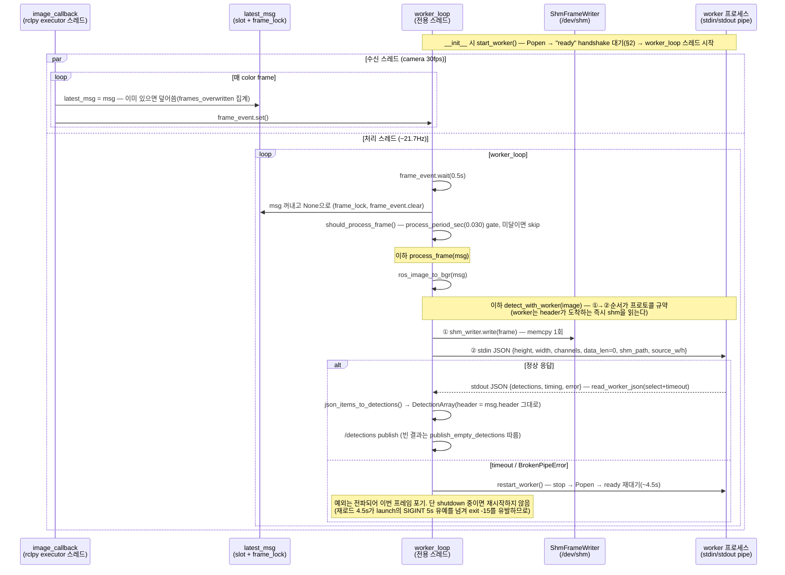
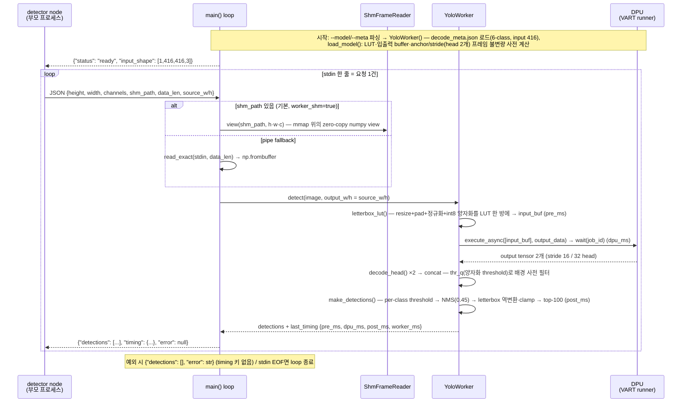
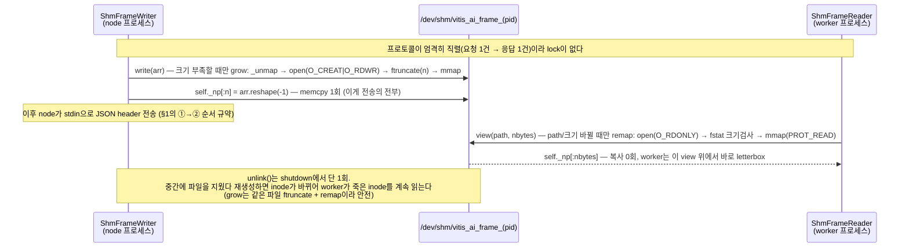
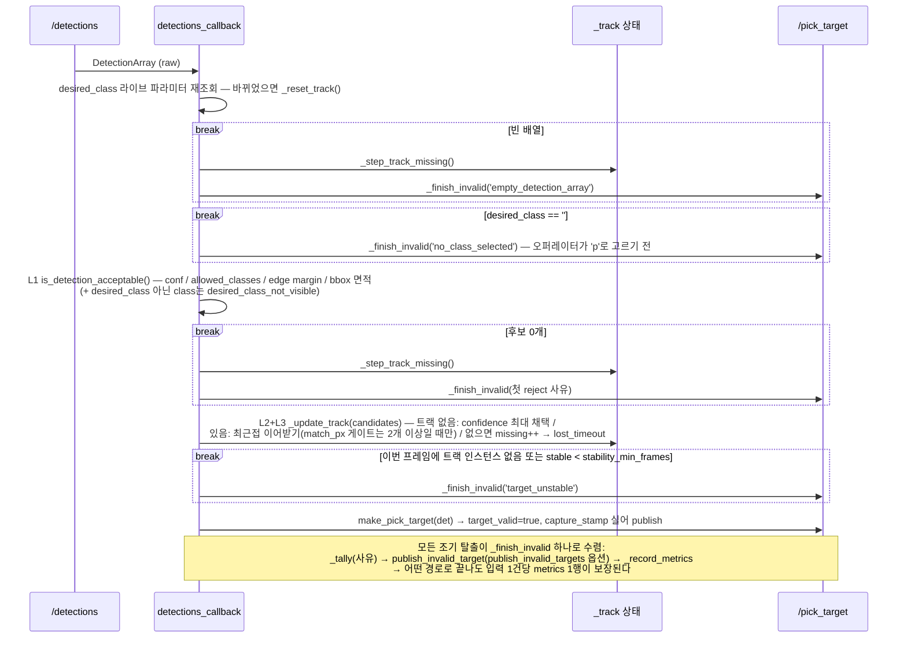
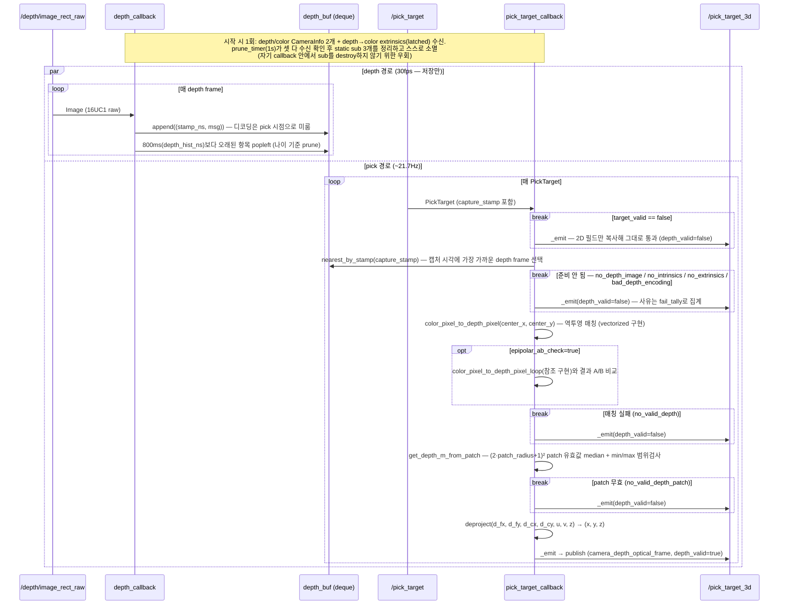
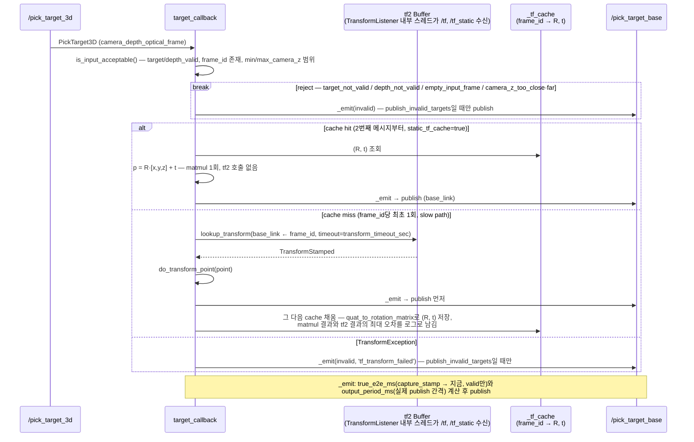

# 파이프라인 노드별 sequence diagram — 코드 공부용

작성 2026-08-19. perception 파이프라인을 구성하는 **python 파일 6개의 내부 구조**를 파일당 1개의 Mermaid sequence diagram으로 정리한다. 함수·토픽·파라미터 이름은 전부 실제 코드의 이름이다(작성일 기준 소스와 대조함).

- **보는 법**: GitHub 웹에서는 자동 렌더. 데스크톱 VS Code는 "Markdown Preview Mermaid Support" 확장 설치 후 preview(Ctrl+Shift+V). 보드 터미널에서는 텍스트로만 보이므로 desktop에서 볼 것. 급하면 <https://mermaid.live>에 블록을 붙여넣어도 된다.
- **detector + worker를 줄 단위로 정독**하려면 `detector_worker_walkthrough.md`(코드 공부용 지도)가 정본이다. 이 문서는 "함수들이 **시간 순으로 어떻게 상호작용하는가**"를 보여주는 보완 자료다.
- PlantUML을 아는 사람을 위한 문법 브리지:

| PlantUML | Mermaid |
|---|---|
| `@startuml … @enduml` | ` ```mermaid … ``` ` 코드 블록 |
| `A -> B : msg` | `A->>B: msg` |
| `A --> B : msg` (응답/점선) | `A-->>B: msg` |
| `loop / alt / else / opt / par / end` | 동일 |
| `note over A,B` | `Note over A,B: …` |
| (없음) | `break 조건 … end` — 조기 탈출(early return) 표현 |

---

## 0. 전체 파이프라인 overview

노드 5개 + worker 프로세스 1개. **`capture_stamp`(color 캡처 시각)가 파이프라인 전체의 join key**라는 것이 핵심이다.

```mermaid
sequenceDiagram
    participant CAM as camera<br/>(realsense2_camera)
    participant DET as vitis_ai_detector_node
    participant WK as vitis_ai_worker_yolo<br/>(자식 프로세스, DPU)
    participant PL as pick_logic_node
    participant T3 as pick_target_3d_node
    participant TB as pick_target_base_node
    participant ROB as CROS2PickBridge<br/>(RAON-RT App/Indy7, APU 실운용;<br/>RPU 이관 시 출력만 seqlock→rpmsg)

    CAM->>DET: /camera/camera/color/image_raw (Image BGR 848x480 @30fps)
    CAM->>T3: /camera/camera/depth/image_rect_raw (Image 16UC1 raw @30fps)
    CAM->>T3: CameraInfo x2 + depth→color extrinsics (시작 시, latched)
    Note over T3: depth_buf(deque)에 800ms 보관 — §5
    DET->>WK: frame(/dev/shm) + JSON header(stdin) — §1·§3
    WK-->>DET: {detections, timing} (stdout JSON) — §2
    DET->>PL: /detections (DetectionArray, ~21.7Hz)
    PL->>T3: /pick_target (PickTarget) — §4
    T3->>TB: /pick_target_3d (PickTarget3D, camera_depth_optical_frame) — §5
    TB->>ROB: /pick_target_base (PickTarget3D, base_link) — §6
    Note over DET,TB: capture_stamp 전파 경로: DetectionArray.header.stamp(=color 캡처 시각)<br/>→ PickTarget.capture_stamp → 그대로 전파.<br/>§5에서 depth 매칭(nearest_by_stamp), §6에서 true_e2e_ms 계산에 사용
```

**해설**
- 노드 사이는 전부 ROS2 토픽이지만, detector↔worker 사이만 **프로세스 경계**(stdin/stdout pipe + /dev/shm)다. 프로세스를 나눈 이유는 VART `execute_async`가 rclpy 프로세스 안에서 segfault를 냈기 때문(§2 참조).
- 전체 rate(~21.7Hz)는 §1의 `process_period_sec` gate 한 곳에서 정해진다 — 성능 얘기는 `docs/vision/throughput.md`가 정본.

---

## 1. `vitis_ai_detector_node.py` (921줄) — ROS 배관 + 2-thread 구조

`src/vitis_ai_detector_pkg/vitis_ai_detector_pkg/vitis_ai_detector_node.py`. 구독 callback과 처리 루프를 **다른 thread로 분리**(callback pipelining)한 것이 구조의 전부다.



**해설**
- `latest_msg`가 **queue가 아니라 1칸 slot**인 이유: moving object에서는 밀린 프레임을 처리하는 것 자체가 손해다. 새 프레임이 오면 덮어쓰고, 덮인 수를 drop으로 집계한다. executor는 절대 DPU를 기다리지 않는다(callback은 저장+event set만 하고 즉시 반환).
- **①shm 먼저 → ②header 나중** 순서는 규약이다. pipe에는 JSON 한 줄만 흐르고 프레임 본문은 /dev/shm mmap으로 전달(2026-08-05, ipc 13.4→4.65ms). `send_resized_input: false`라 848×480 원본이 그대로 가고 letterbox는 worker가 한다.
- `timing`(§2)과 자신의 시계를 비교해 `ipc_overhead_ms = worker_call_ms − worker_ms`를 계산 — IPC 비용이 metrics로 상시 감시된다.
- 종료는 역순: `stop_pipeline()`(shutdown_event + join) → metrics 저장 → `stop_worker()`(stdin close → terminate → SIGKILL 에스컬레이션) → `shm_writer.unlink()` — **unlink는 여기 한 곳뿐**(§3의 inode 함정).

---

## 2. `vitis_ai_worker_yolo.py` (451줄) — DPU 추론 프로세스

`src/vitis_ai_detector_pkg/vitis_ai_detector_pkg/vitis_ai_worker_yolo.py`. **ROS가 아니다** — rclpy import조차 없는 순수 프로세스이고, 통신은 stdin/stdout 뿐이다. thread도 없다(요청 1건씩 엄격히 직렬).



**해설**
- 프로세스로 분리한 이유: VART `execute_async`가 rclpy 프로세스 안에서 segfault → **process isolation**으로 해결. `graph`/`dpu_subgraphs`를 `self`에 계속 잡아두는 것도 같은 맥락(해제하면 execute_async가 죽을 수 있음).
- `load_model()`이 프레임 불변량(LUT, buffer, anchor, thr_q)을 전부 시작 시 1회 계산해 두므로 loop 안은 순수 연산만 남는다. preprocess(LUT)와 background 사전 필터는 naive 구현과 **bit-identical** 검증됨.
- `CLASS_THRESHOLDS_BY_NAME`에서 person은 threshold 2.0 — confidence는 1.0을 못 넘으므로 사실상 출력이 차단돼 있다. (2026-09: pick_logic의 person guard는 제거됐다 — 이 threshold를 낮춰도 되살아나는 안전장치는 없다.)
- import 특이점: node가 이 파일을 **절대경로 스크립트로 Popen**하므로 `from shm_frame import …` fallback이 있고, 테스트는 패키지 모듈(`from vitis_ai_detector_pkg.shm_frame import …`)로 import한다.

---

## 3. `shm_frame.py` (96줄) — /dev/shm 프레임 전달

`src/vitis_ai_detector_pkg/vitis_ai_detector_pkg/shm_frame.py`. 클래스 2개(96줄)가 §1↔§2 사이 프레임 본문 전달을 담당한다.



**해설**
- 같은 해상도가 계속 오는 정상 운전에서는 양쪽 다 mmap을 재사용하므로, 프레임당 비용은 **writer의 memcpy 1회**뿐이다(reader는 zero-copy view).
- worker가 응답을 보내기 전에는 node가 buffer를 다시 쓰지 않는다는 직렬성 위에서만 안전한 설계다 — §1·§2의 loop가 그 직렬성을 보장한다.
- **inode 함정**: 디버깅 중에도 `/dev/shm/vitis_ai_frame_*`를 절대 지우지 말 것(모듈 docstring에도 명시).

---

## 4. `pick_logic.py` (477줄, v3 2026-09-04) — 2D 필터 ladder + 단일 인스턴스 추적

`src/pick_logic_pkg/pick_logic_pkg/pick_logic.py`. thread도 IPC도 없는 단일 callback — 구조의 전부는 **L1→L2→L3 ladder와, 모든 조기 탈출이 `_finish_invalid` 한 경로로 수렴**한다는 것이다. v3에서 v2의 점수식(`_score`)과 hysteresis 전환, AUTO 모드가 빠졌다 — 오퍼레이터가 지정한 클래스의 인스턴스 1개를 골라 잃을 때까지 붙어 있는다(sticky).



**해설**
- `desired_class`는 매 frame 재조회하는 **live parameter**다(로봇 쪽 operator 메뉴가 바꾼다). 바뀌면 tracking 상태를 리셋.
- `_update_track`은 프레임 간 상태(`_track`)를 가진 유일한 곳. 트랙은 **sticky**: 한 번 채택된 인스턴스는 더 좋은 후보가 나와도 바뀌지 않고 `lost_timeout_frames` 연속 사라져야 해제된다(v2의 hysteresis 전환은 추종 중 TCP를 다른 물체로 끌고 갈 수 있어 삭제). 같은 클래스가 2개 이상일 때는 최근접 + `stability_match_px` 게이트로 구분한다 — 실험은 클래스당 1개지만 검출기가 같은 클래스 박스를 2개 낼 수 있어(긴 물체 분할, 오검출) 동작을 정의해 둔 것. 근거 전문은 그 함수의 docstring.
- `capture_stamp`(=DetectionArray.header.stamp=색상 캡처 시각)를 PickTarget에 실어 보내는 것이 §5·§6의 전제.

---

## 5. `pick_target_3d_node.py` (645줄) — depth 매칭 + 역투영

`src/target_3d_pkg/target_3d_pkg/pick_target_3d_node.py`. 독립 callback 두 개가 `depth_buf`(deque)를 사이에 두고 만난다.



**해설**
- **deque(800ms 역사)이지, latest 1장이 아니다.** detection이 캡처보다 ~90ms 늦게 도착하므로 "가장 최신 depth"는 파트너보다 ~3프레임 뒤다 — `nearest_by_stamp`로 캡처 시각에 맞는 frame을 되찾아야 skew가 36ms → 4.3ms가 된다(2026-08-04). **latest 1장으로 "단순화"하면 안 된다.**
- prune이 `maxlen`이 아니라 **나이 기준**인 이유: depth fps(15/30)는 설정값이라, 길이 고정이면 fps 바꿀 때 역사 길이가 달라진다.
- depth_callback이 **저장만** 하는 이유: 디코딩을 30fps 전부에 하면 낭비 — 실제 쓰는 pick 시점(~21.7Hz)에만 `depth_msg_to_view`(cv_bridge 없는 frombuffer view, 1회 등가성 검증)로 디코딩.
- 어떤 경로로 끝나든 `_emit` 한 곳을 지나므로 입력 1건당 출력/metrics 1행이 보장된다. `_emit`은 실제 사용한 depth frame 기준 skew(`depth_vs_color_skew_ms`)와 "latest를 썼다면"의 skew(`skew_if_latest_ms`)를 같이 기록해 상시 A/B가 된다.

---

## 6. `pick_target_base_node.py` (353줄) — base_link 변환

`src/target_3d_pkg/target_3d_pkg/pick_target_base_node.py`. 마지막 단계 — camera frame의 (x,y,z)를 `base_link`로 옮긴다. 구조의 핵심은 **tf2 lookup을 frame_id당 1회만 하고 (R, t)를 cache**하는 것.



**해설**
- cache가 정당한 이유: `base_link → camera` TF는 **static**(launch 인자에 박힌 캘리브 실측 고정값)이라 매번 tf2 lookup을 하는 것이 순수 낭비다. 대신 최초 1회는 tf2 정답과 matmul 결과의 오차를 로그로 검증하고 나서 cache에 넣는다.
- slow path에서 **publish가 cache 채우기보다 먼저**다 — 첫 메시지의 지연을 늘리지 않기 위해.
- `true_e2e_ms`가 여기서 나온다: color 캡처(capture_stamp)부터 base 좌표 publish까지 — CLAUDE.md의 "capture→base E2E p50 ~118ms"가 이 값이다.
- TF는 **2026-07-27 eye-to-hand 캘리브 실측치**(16 poses, AX=ZB, 잔차 1.8 cm / 1.7°) + E21 베이스 재보정(yaw +5.14°)이다(`launch/pick_place_vitis_ai.launch.py:236-264`) — 여기서 나오는 base 좌표가 곧 로봇이 접근·추종에 쓰는 실좌표다.
